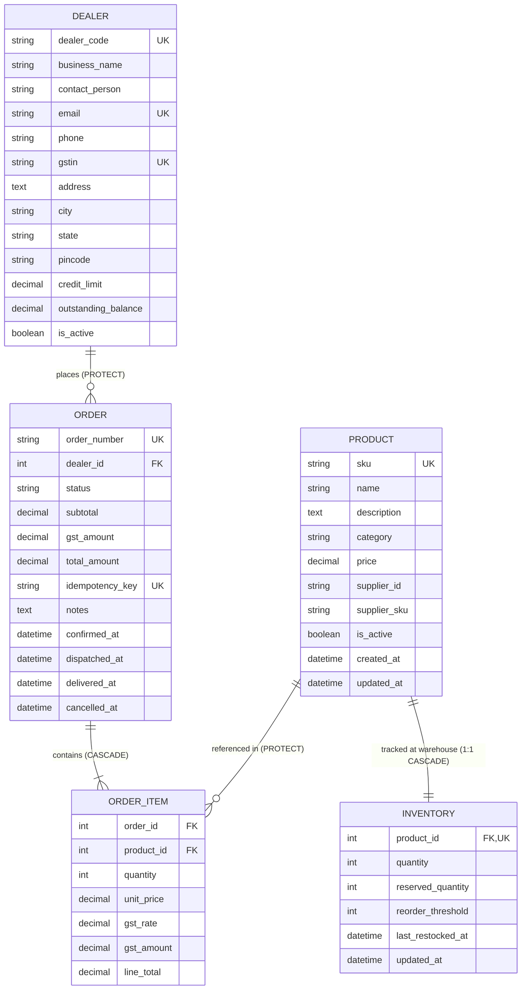

# DealerDesk - B2B Dealer Ordering Backend

## Project Purpose

**DealerDesk** is a B2B dealer ordering backend for an automotive spare parts distributor based in Bengaluru, Karnataka. The distributor maintains a catalogue of approximately 600 products and supplies 25 authorized dealers located across South India (Karnataka, Tamil Nadu, Kerala, Andhra Pradesh, and Telangana).

The system serves as the foundational data and transaction layer for:
- Product catalogue and automotive parts inventory tracking
- Authorized dealer accounts and GSTIN-compliant invoicing
- Order lifecycle management (Draft, Confirmed, Dispatched, Delivered, Cancelled)
- Price locking and historical order auditability
- Strict stock allocation, GST calculations, supplier synchronization, and AI-assisted workflows

---

## Assignment Track

- **Selected Track:** `django`

---

## Technologies Used

- **Python**: 3.13+
- **Django**: 5.1+ / 6.0 (Django ORM, Migrations, Admin)
- **Django REST Framework**: 3.15+
- **JWT Authentication**: `djangorestframework-simplejwt`
- **OpenAPI 3.0 Documentation**: `drf-spectacular` (Swagger UI & ReDoc)
- **Database Engine**: PostgreSQL (`django.db.backends.postgresql` with `psycopg[binary]`)
- **Environment Management**: `python-dotenv`

> **Note on Database Choice**: SQLite is strictly prohibited (even as a fallback) to ensure full compatibility with PostgreSQL transactions, row-level locking, and concurrency testing.

---

## Project Structure

```
vikmo/
├── .env.example              # Documented template for PostgreSQL & Django environment variables
├── .gitignore                # Git ignore patterns for Python, Django, venv, and environment files
├── requirements.txt          # Production and development dependencies
├── manage.py                 # Django management CLI entry point
├── README.md                 # Project documentation and architectural summary
├── dealerdesk/               # Project configuration package
│   ├── __init__.py
│   ├── asgi.py              # ASGI configuration
│   ├── settings.py          # Django settings (PostgreSQL backend, DRF, apps, environment loading)
│   ├── urls.py              # Root routing configuration (includes Django Admin)
│   └── wsgi.py              # WSGI configuration
└── inventory/                # Inventory and ordering core application
    ├── __init__.py
    ├── admin.py             # Django Admin model registrations with inlines and filters
    ├── apps.py              # Inventory application configuration
    ├── models.py            # Domain models: Product, Inventory, Dealer, Order, OrderItem
    ├── migrations/          # Schema migrations
    │   ├── __init__.py
    │   └── 0001_initial.py  # Initial migration generated for the 5 domain models
    ├── tests.py             # Application tests
    └── views.py             # Views placeholder for upcoming API endpoints
```

---

## Data Models & Relationships

DealerDesk defines five core database entities in `inventory/models.py`:



### 1. Product
- **Purpose**: Represents an automotive spare part in the distributor's catalogue (~600 SKUs).
- **Key Attributes**: Unique `sku`, indexed `name`, `description`, `category`, current catalogue `price` (DecimalField in INR), `supplier_id`, `supplier_sku`, `is_active`, timestamps.
- **Constraints**: Database check constraint enforcing `price >= 0.00`.

### 2. Inventory
- **Purpose**: Tracks physical stock quantity and reservations at the Bengaluru distribution facility.
- **Cardinality**: `1:1` relationship with `Product` (`OneToOneField`), reflecting single-warehouse central stock tracking.
- **Key Attributes**: `product`, `quantity` (on-hand physical stock), `reserved_quantity` (stock committed to confirmed orders), `reorder_threshold`, `last_restocked_at`.
- **Constraints**: Check constraints enforcing `quantity >= 0` and `reserved_quantity >= 0`.

### 3. Dealer
- **Purpose**: Represents an authorized B2B dealership customer in South India.
- **Key Attributes**: Unique `dealer_code`, `business_name`, `contact_person`, unique `email`, `phone`, unique `gstin` (15-character GST Identification Number), address, `city`, `state`, `credit_limit`, `outstanding_balance`, `is_active`.
- **Constraints**: Check constraint enforcing non-negative `credit_limit >= 0.00`.

### 4. Order
- **Purpose**: Represents a purchase order placed by a dealer.
- **Relationships**: `dealer = ForeignKey(Dealer, on_delete=models.PROTECT)` to guarantee referential integrity and prevent accidental deletion of dealers with order history.
- **Key Attributes**: Unique `order_number`, `status` (`DRAFT`, `CONFIRMED`, `DISPATCHED`, `DELIVERED`, `CANCELLED`), monetary fields (`subtotal`, `gst_amount`, `total_amount`), unique `idempotency_key` (duplicate submission prevention), status transition timestamps (`confirmed_at`, `dispatched_at`, `delivered_at`, `cancelled_at`).
- **Constraints & Indexes**:
  - Check constraints for non-negative monetary totals (`subtotal >= 0`, `gst_amount >= 0`, `total_amount >= 0`).
  - Composite indexes on `['dealer', 'status']` and `['status', 'created_at']` for query performance.

### 5. OrderItem
- **Purpose**: Represents an individual product line in an order.
- **Relationships**:
  - `order = ForeignKey(Order, on_delete=models.CASCADE)`
  - `product = ForeignKey(Product, on_delete=models.PROTECT)`: Preserves catalogue part integrity so parts with order history cannot be purged from the database.
- **Price Locking & Snapshots**:
  - Stores snapshot values for `unit_price`, `gst_rate`, `gst_amount`, and `line_total` at the time of order placement/confirmation.
  - Insulates historical orders and tax audit trails from subsequent catalogue price adjustments.
- **Constraints**:
  - Unique constraint `UniqueConstraint(fields=['order', 'product'])` preventing duplicate lines for the same part within an order.
  - Check constraints enforcing `quantity >= 1`, non-negative `unit_price`, `gst_rate`, `gst_amount`, and `line_total`.

---

## Installation & Running Django Checks

### 1. Prerequisites
- Python 3.10+ (Python 3.13 recommended)
- `pip`

### 2. Environment Setup
Create and activate a virtual environment:
```bash
# Windows PowerShell
python -m venv .venv
.\.venv\Scripts\Activate.ps1

# Linux / macOS
python3 -m venv .venv
source .venv/bin/activate
```

Install project dependencies:
```bash
pip install -r requirements.txt
```

### 3. Run Django System Checks
Validate the project configuration and model definitions without requiring a live database connection:
```bash
python manage.py check
```

Validate migration status:
```bash
python manage.py makemigrations --check --dry-run
```

---

## Configuring PostgreSQL Database via Environment Variables

DealerDesk reads its PostgreSQL connection parameters from environment variables (or a local `.env` file).

### Step 1: Create `.env` file
Copy `.env.example` to `.env`:
```bash
cp .env.example .env
```

### Step 2: Configure PostgreSQL variables
Update `.env` with your PostgreSQL database credentials:

| Environment Variable | Description | Default (if unset) |
|---|---|---|
| `DB_NAME` | PostgreSQL database name | `dealerdesk` |
| `DB_USER` | PostgreSQL user | `postgres` |
| `DB_PASSWORD` | PostgreSQL user password | `""` (empty) |
| `DB_HOST` | PostgreSQL host address | `localhost` |
| `DB_PORT` | PostgreSQL port | `5432` |
| `SECRET_KEY` | Django secret key | Development fallback |
| `DEBUG` | Enable/disable debug mode (`True`/`False`) | `True` |
| `ALLOWED_HOSTS` | Comma-separated allowed hostnames | `localhost,127.0.0.1` |

### Step 3: Apply Migrations (When PostgreSQL is running)
Once PostgreSQL is running and the database is created, apply the migrations:
```bash
python manage.py migrate
```
